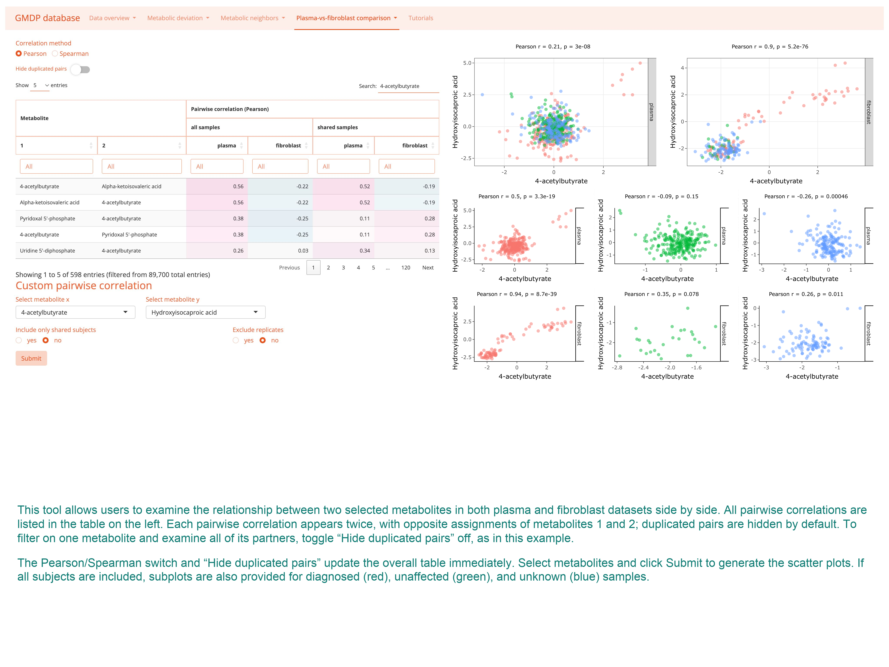

# The Genetic and Metabolic Disease Program Database App

This is the source repository for the [Genetic and Metabolic Disease Program](https://cri.utsw.edu/genetic-and-metabolic-disease-program/) Database Shiny app from the [Children's Research Institute](https://cri.utsw.edu/) and the [Quantitative Biomedical Research Center](https://qbrc.swmed.edu/) at UT Southwestern Medical Center.

**Live application:** [GMDP Metabolomics Data Explorer](https://lccl.shinyapps.io/GMDP/). Instructions and worked examples are available in its **Tutorials** section.

## Current application

The source and static assets reflect the application deployed on October 24, 2026, including:

- Pearson and Spearman correlation options in all six correlation tools, with Pearson selected by default.
- Saved Spearman overview tables, method-specific statistics and downloads, and controls that apply submitted selections consistently.
- Compact correlation controls with orange text and peach buttons, plus 14 refreshed tutorial PNGs at 4096 × 3072 resolution.
- A dashboard that fits desktop and tablet viewports, expandable chart cards, and responsive navigation and phone layouts.
- Processed-data downloads, robust Z-score views, and reaction coverage and missing-illustration handling.



## Repository contents

`app.R` assembles the application. `UI/` and `Server/` contain its module interfaces and server logic; `R/` contains the shared correlation helpers and saved-table loader. `www/` contains the deployed images, tutorials, styles, and dashboard JavaScript. `scripts/` provides dependency setup, Spearman-cache generation, and deployment helpers. `tests/` contains correlation, saved-table, and interactive-heatmap regression checks.

## Run locally

The tested runtime is **R 4.3.2 with Bioconductor 3.18**. From the repository root:

```sh
Rscript scripts/setup_local.R
```

The runtime `data/` directory is distributed separately and is not included in this source repository. Place the application data in `data/`, including `input.RData` and the supporting files expected by the modules. With those files available, create the saved Spearman table if it is missing or the input data have changed:

```sh
Rscript scripts/build_pairwise_spearman.R
Rscript run_local.R
```

The launcher prints the local URL. It prefers port 3838 and selects another available port if needed. In RStudio, run `source("run_local.R")` from this repository. Dependencies are installed into the ignored `.R-library/` directory.

## Correlation behavior

Spearman is available for clustering, correlation-based neighbor distances, plasma–fibroblast concordance, custom metabolite pairs, pathway correlations, and reaction correlations. Absolute correlation distance is `1 - abs(coefficient)`. Spearman calculations use finite paired observations, full-precision ranks, average ranks for ties, and two-sided asymptotic P values. Constant inputs or fewer than three finite pairs yield an undefined correlation.

The custom overview table responds immediately to the method and duplicate-pair controls; its scatter plots update on Submit. Concordance tables update on Confirm correlation input, and each concordance scatter plot has its own Submit button. Other correlation modules apply their settings on their associated submission button. Plot asterisks and the pathway significance filter use nominal P < 0.05; concordance downloads additionally include BH-adjusted P values.

## Validation

With the runtime data and dependencies installed:

```sh
Rscript tests/test_correlations.R
Rscript tests/test_pairwise_cache.R
Rscript tests/test_heatmap_widget.R
```

These checks cover Pearson/Spearman calculations, the six correlation modules, saved coefficients, submission behavior, and interactive heatmap initialization and reuse.

## Deployment

The deployment helper targets the existing `lccl/GMDP` application on shinyapps.io. Configure that account separately using rsconnect, then run:

```sh
Rscript scripts/deploy.R
```

It includes only the application runtime source, `data/`, and `www/`. Local package libraries, caches, tests, Git history, and authentication files are excluded from the deployment bundle. Runtime data, credentials, local session files, and deployment records are also excluded from this Git repository.

## License

The source is distributed under the [MIT License](LICENSE).
